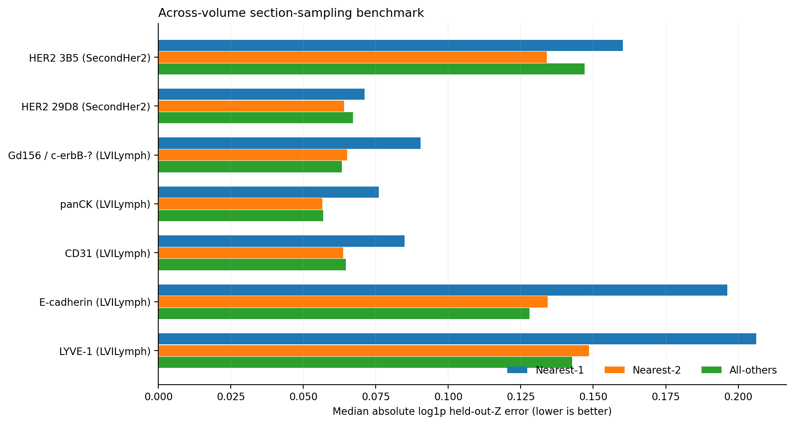
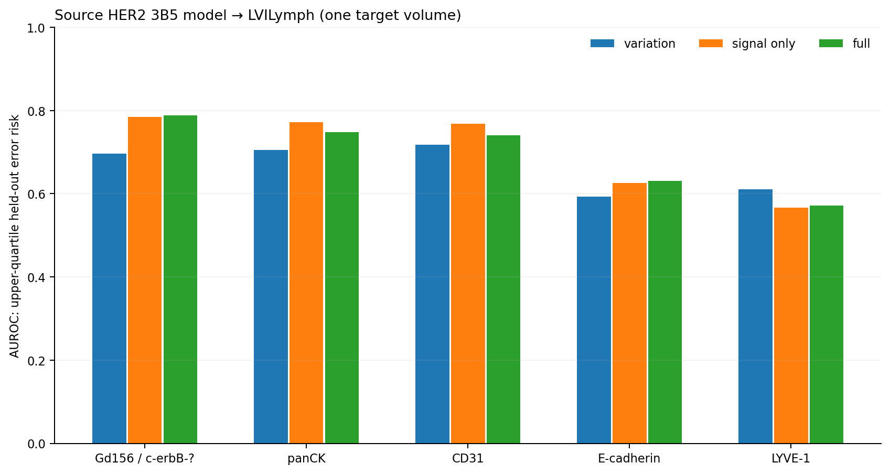
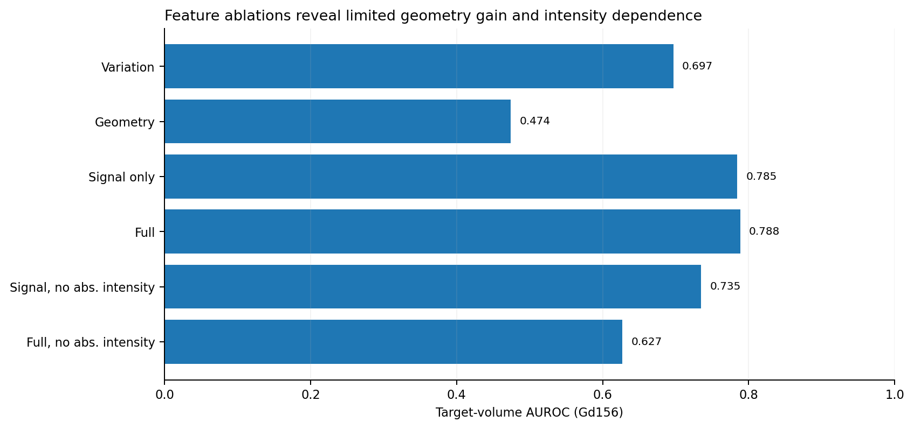

# 3D-TissueMap AI

Reproducible research code for **3D imaging mass cytometry (IMC)**, with an
emphasis on serial-section protein quantification, Z-sampling error, spatial
heterogeneity, and measurement-reliability assessment.

<!-- MAIN_RESULTS_SHOWCASE_START -->
## Main results

Two 3D imaging mass cytometry (IMC) volumes were evaluated using a fixed held-out-middle-Z protein-signal prediction task. The source pseudo-instance mask was known across the complete volume; the held-out signal was not used to predict itself.

### 1. Local Z-section sampling

| Volume / protein channel | Nearest-1 median error | Nearest-2 median error | Median error reduction |
|---|---|---|---|
| HER2 3B5 (SecondHer2) | 0.16015 | **0.13390** | 16.4% |
| HER2 29D8 (SecondHer2) | 0.07116 | **0.06401** | 10.0% |
| Gd156 / c-erbB-? (LVILymph) | 0.09037 | **0.06507** | 28.0% |
| panCK (LVILymph) | 0.07608 | **0.05657** | 25.6% |
| CD31 (LVILymph) | 0.08486 | **0.06380** | 24.8% |
| E-cadherin (LVILymph) | 0.19622 | **0.13434** | 31.5% |
| LYVE-1 (LVILymph) | 0.20628 | **0.14855** | 28.0% |

_Absolute log1p prediction error; lower is better. All-others is also compared in the figure and detailed results._

### 2. Portable measurement-risk prediction

- **Gd156 external AUROC:** variation **0.697**; signal-only **0.785**; full signal + geometry **0.788**.
- **Full − signal-only ΔAUROC:** +0.00385; paired spatial-block bootstrap interval [-0.01851, +0.02336]. No established independent geometry benefit.
- The source-trained model was frozen before the target-volume risk evaluation. Risk labels reflect **within-target upper-quartile held-out error**, not manual biological ground truth.

### 3. Feature-ablation results

The full model is strongly affected by removal of an explicit absolute-intensity feature, and transfer varies by marker (especially LYVE-1). 
The more complex reliability-guided **hotspot filtering did not improve** the downstream task and is not presented as a validated benefit.

**Interpretation:** these are two 3D tissue volumes, not a demonstrated independent patient cohort. LVILymph Gd156 is provisionally mapped to a truncated `c-erbB-` antigen label. The model uses a pseudo-instance segmentation and proxy held-out-Z measurement targets; no manual 3D cell reference is claimed.

See [full results, statistics, and limitations](docs/RESULTS.md), [research workflows](docs/WORKFLOWS.md), and [reproducibility](docs/REPRODUCIBILITY.md).
<!-- MAIN_RESULTS_SHOWCASE_END -->

## Research scope

- SecondHer2 breast-cancer 3D volume (92 sections; dual HER2 assays): source
  analyses of segmentation sensitivity, sampling, and reliability.
- LVILymph breast-cancer 3D volume (16 aligned sections): cross-volume
  sampling and portable reliability evaluation across multiple channels.
- Source/target **pseudoinstance masks are not manual 3D cell ground truth**.
  Heldout-Z experiments use the target-plane signal as a **proxy** reference,
  while object geometry comes from the existing full-volume segmentation.
- Data from two volumes should not be treated as independent patient cohorts.

## Code organization

Original entry-point paths are preserved under `scripts/` because scripts can
import each other. The navigation index is in [docs/WORKFLOWS.md](docs/WORKFLOWS.md).
There were 261 eligible source files copied in this export; see the audit manifest.

`releases/` contains selected **code and documentation** from the local
research releases, not raw experimental outputs.

## Reproducibility

The repository does **not** contain raw OME-TIFF images, segmentation TIFFs,
large model weights, personal paths, patient-level metadata, or raw per-object
outputs. Reproduce experiments by obtaining the original data from its
rights-holder and configuring the required local `data/` and `runs/` paths.
See [docs/REPRODUCIBILITY.md](docs/REPRODUCIBILITY.md).

### Typical research workflow

1. Dataset provenance and channel identity audit.
2. Registration and 3D pseudoinstance QC.
3. Per-Z object-level protein quantification.
4. Z-sampling and heldout-signal evaluation.
5. Risk prediction and spatially blocked validation.
6. Cross-volume validation and feature ablation.
7. Figure generation and manuscript evidence snapshot.

This repository includes exploratory and negative-result scripts. A method's
presence is **not** evidence of superiority or biological validation.
See the experiment protocol and paper for exact claims and limitations.

## License and dataset rights

**No software license is granted by this repository unless the owner adds one.**
Third-party IMC datasets and associated masks retain their original data terms.

<!-- 3D_VIEWERS_START -->
## Interactive 3D tissue viewers

Explore the reconstructed imaging mass cytometry tissue using two browser-based viewers. These are **research visualizations**, not manual ground-truth cell segmentations.

| Interactive tool | Description | Launch |
|---|---|---|
| 3D ROI voxel viewer | Voxel-based 3D tissue visualization | [Open viewer](https://great-sophie.github.io/3D-TissueMap-AI/viewers/roi_voxel_viewer.html) |
| 3D centroid and marker viewer | 3D spatial pseudo-instances and protein-marker visualization | [Open viewer](https://great-sophie.github.io/3D-TissueMap-AI/viewers/centroid_marker_viewer.html) |

**[Open the 3D viewer gallery](https://great-sophie.github.io/3D-TissueMap-AI/viewers/index.html)** · [Viewer documentation](docs/VIEWERS.md)

> The interactive HTML files are distributed as static pages. The underlying 3D pseudo-instance geometry does not constitute independently validated cell ground truth. Marker labels and redistribution rights require verification.
<!-- 3D_VIEWERS_END -->
